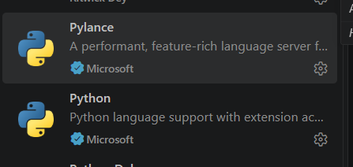
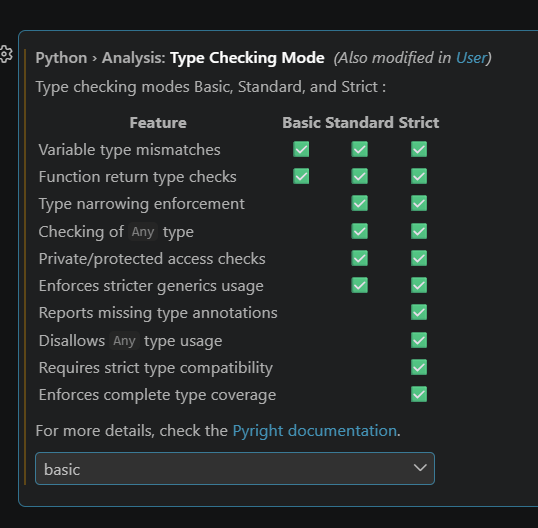
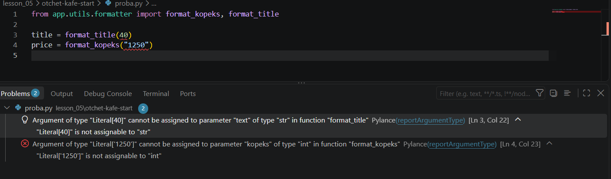
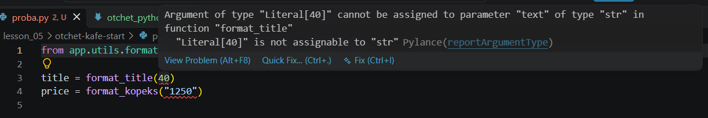
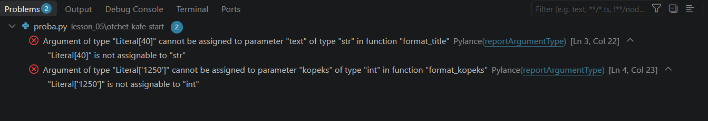
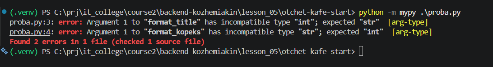
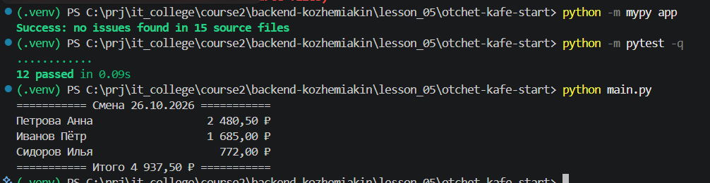

# Отчёт · Проверка типов: Pylance и mypy

**Студент:** Кожемякин Эрик, группа: 9/2-РПО-25/1

## 1. Подготовка





## 2. Проверка в редакторе

```python
from app.utils.formatter import format_kopeks, format_title

title = format_title(40)
price = format_kopeks("1250")
```





Разбор сообщения: Argument of type "Literal[40]" cannot be assigned to parameter "text" of type "str" in function "format_title"
  "Literal[40]" is not assignable to "str" 

| Часть сообщения | Что означает |
|---|---|
| `Argument of type "Literal[40]"` | Передан аргумент со значением `40` типа `int` (целое число). `Literal[40]` означает конкретное значение `40`. |
| `cannot be assigned to parameter "text" of type "str"` | Аргумент нельзя передать параметру `text`, потому что он ожидает строку (`str`), а не целое число. |
| `in function "format_title"` | Ошибка возникает при вызове функции `format_title`, которой передали аргумент неподходящего типа. |



## 3. Проверка в терминале

```text
python -m mypy .\proba.py
proba.py:3: error: Argument 1 to "format_title" has incompatible type "int"; expected "str"  [arg-type]
proba.py:4: error: Argument 1 to "format_kopeks" has incompatible type "str"; expected "int"  [arg-type]
Found 2 errors in 1 file (checked 1 source file)
```



После исправления, вывод стал

```text
Success: no issues found in 1 source file
```

## 4. Проект без аннотаций

| Этап | Итог `mypy app` |
|---|---|
| исходно | `Found 17 errors in 10 files (checked 15 source files)` |
| после `utils` | Found 12 errors in 7 files (checked 15 source files) |
| после `domain` | Found 8 errors in 5 files (checked 15 source files) |
| после `services` | Found 1 error in 1 file (checked 15 source files) |
| после `ui` | Success: no issues found in 15 source files |

Модуль до и после имя модуля: calculator.py

```python
def calculate_average(grades):

def grade_bounds(grades):
```

```python
def calculate_average(grades: list[int]) -> float:

def grade_bounds(grades: list[int]) -> tuple[int, int]:
```

```text
(.venv) PS > python -m mypy app
Success: no issues found in 15 source files
(.venv) PS > python -m pytest -q
............                                                                                                                                                                     [100%]
12 passed in 0.09s
(.venv) PS > python main.py
=========== Смена 26.10.2026 ===========
Петрова Анна                  2 480,50 ₽
Иванов Пётр                   1 685,00 ₽
Сидоров Илья                    772,00 ₽
=========== Итого 4 937,50 ₽ ===========
```



## 5. Выводы

Pylance и mypy находят ошибки типов, например передачу числа вместо строки, а также несоответствия между аргументами и параметрами функций. Неожиданным оказалось то, что такие ошибки можно обнаружить ещё до запуска программы. Проверка типов помогает находить потенциальные проблемы, но не гарантирует правильную работу программы. Она не всегда обнаруживает логические ошибки, неправильные алгоритмы и проблемы, возникающие во время выполнения.
