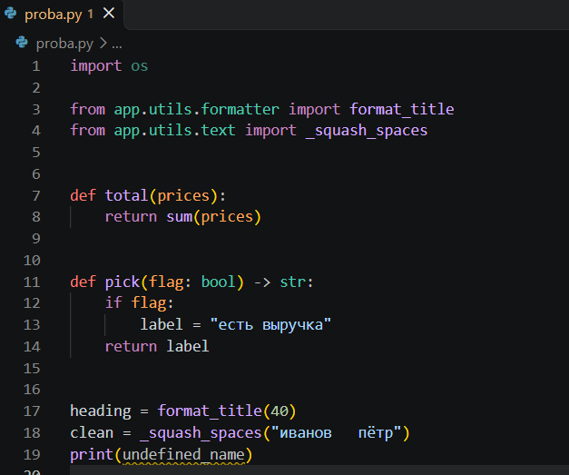
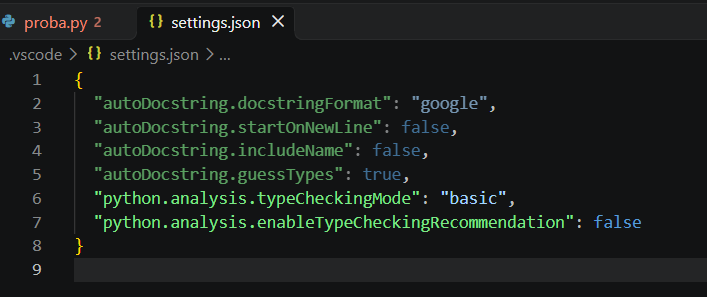
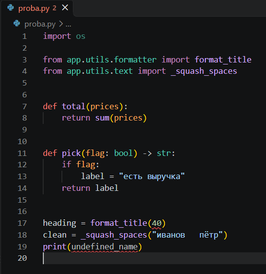
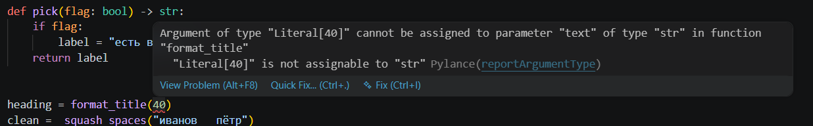
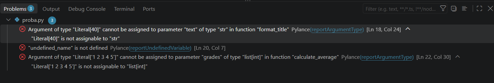
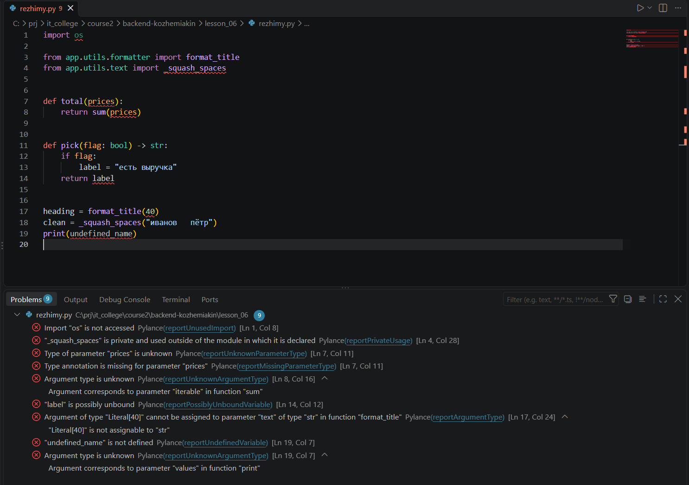
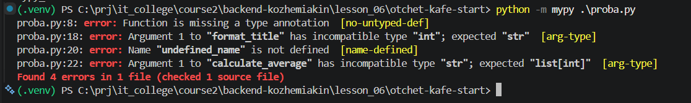
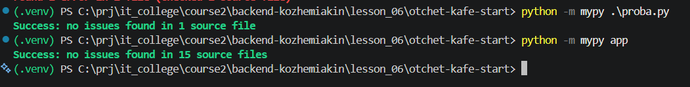
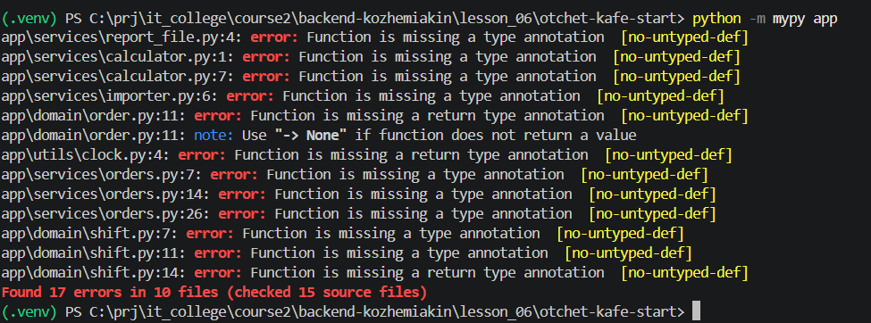
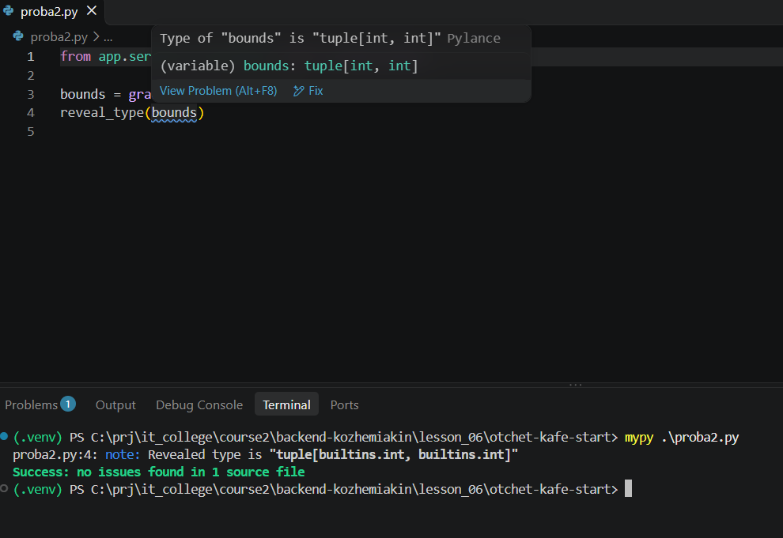

# Отчёт · Проверка типов: Pylance и mypy

**Студент:** Кожемякин Эрик, группа: 9/2-РПО-25/1

Работа выполнена на втором архиве проекта «Отчёт кафе»
(`lesson_06/otchet-kafe-start`), глава 4.3.

## 1. Редактор до настройки

В корне проекта создан файл `proba.py` с двумя неверными вызовами:
`format_title(40)` и `format_kopeks("1250")`. Выбран интерпретатор
из окружения проекта, внизу справа окна написано `.venv (3.13.15)`.

В режиме `off` в файле подчёркнуто 0 аргументов. Ошибки типов в этом
режиме не показываются, аннотации идут только в подсказки.

## 2. Включение режима basic

Настройка `python.analysis.typeCheckingMode` выбрана на вкладке workspace,
поэтому VS Code записал её в файл `.vscode/settings.json` внутри проекта.

## 3. Ошибки в редакторе

После смены режима в `proba.py` подчёркнуты 40 и undefined_name. На вкладке
после имени файла стоит цифра 2.

Сообщение над `40`:

Pylance называет тип переданного значения `Literal[40]`. Параметр `text`
функции `format_title` ожидает тип `str`. Правило, по которому
выдано сообщение, называется `reportArgumentType`.

Мой вариант — нерпавильного аргумента. В `proba.py` добавлен вызов `calculator.calculate_average("1 2 3 4 5")`, он стоит
в строке 22. Функция объявлена в модуле `calculator`, её подпись:
`def calculate_average(grades: list[int]) -> float`.

В панели Problems у `proba.py` 3 ошибки. Моя ошибка стоит
на месте `[Ln 22, Col 30]`, её короткая причина в конце сообщения:
`Literal['1 2 3 4 5']" is not assignable to "list[int]`.

## 5. Четыре режима на одном файле

Файл `rezhimy.py` проверен во всех четырёх режимах.
Число сообщений в панели Problems:

| Режим | Сообщений |
|---|---|
| `off` | 0 |
| `basic` | 2 |
| `standard` | 3 |
| `strict` | 9 |

Только в `standard` и `strict` появилось сообщение про переменную
`label`: `"label" is possibly unbound`. После опыта возвращён режим `basic`.

## 6. Ошибки в терминале

Версия mypy: `1.15.0`. Команда `mypy proba.py` закончилась строкой
`Found 4 errors in 1 file (checked 1 source file)`.

Строка с моей ошибкой: `proba.py:22: error: Argument 1 to "calculate_average" has incompatible type "str"; expected "list[int]"  [arg-type]`.
В сообщении mypy параметр назван `str`, а Pylance называл его `Literal['1 2 3 4 5']`.

## 7. Исправление

Исправленные вызовы:
def total(prices: list[int]) -> int:

| Было | Стало |
|---|---|
| `def total(prices):` | `def total(prices: list[int]) -> int:` |
| `format_title(40)` | `format_title("test", 40)` |
| `print(undefined_name) ` | `print(clean)` |
| `calculator.calculate_average('1 2 3 4 5')` | `calculator.calculate_average([1,2,3,4,5])` |

После сохранения файла проверка повторена.

`mypy proba.py`: `Success: no issues found in 1 source file`.
`mypy app`: `Success: no issues found in 15 source files`.

## 8. Проект без аннотаций

На первом архиве mypy вывел `Found ___ errors in ___ files`.
У всех ошибок код `___`. Ошибки появились потому, что в `pyproject.toml`
включён параметр `disallow_untyped_defs = true`.

Первая строка списка: `___`.

## 9. Какой тип видит проверка

Type of "bounds" is "tuple[int, int]"

Pylance при наведении на `bounds` показал `tuple[int, int]`. mypy в строке
`reveal_type` вывел `tuple[builtins.int, builtins.int]`.

## 10. Итог

Если Pylance ошибок не показывает, а mypy показывает, первым делом
проверяю, настройки проверки типов и конфигурацию mypy.

ИИ: не использовался
