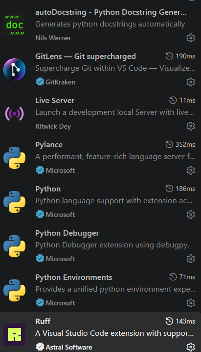
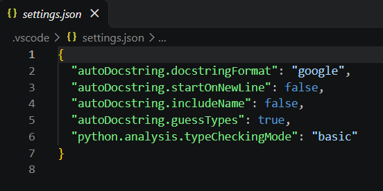
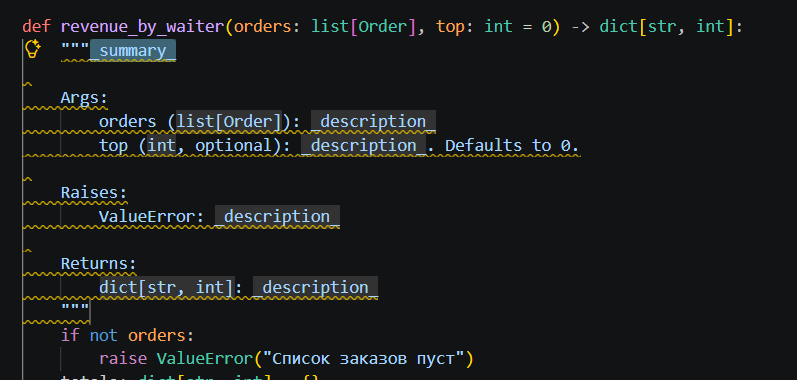
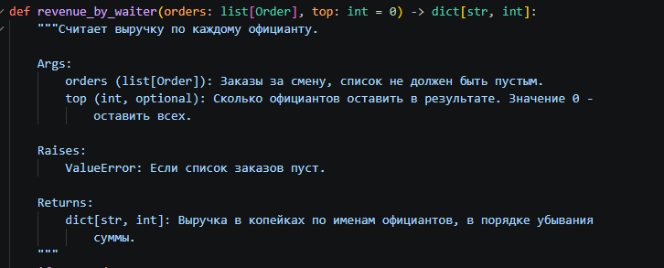
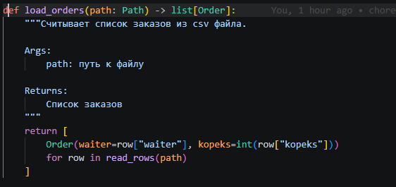
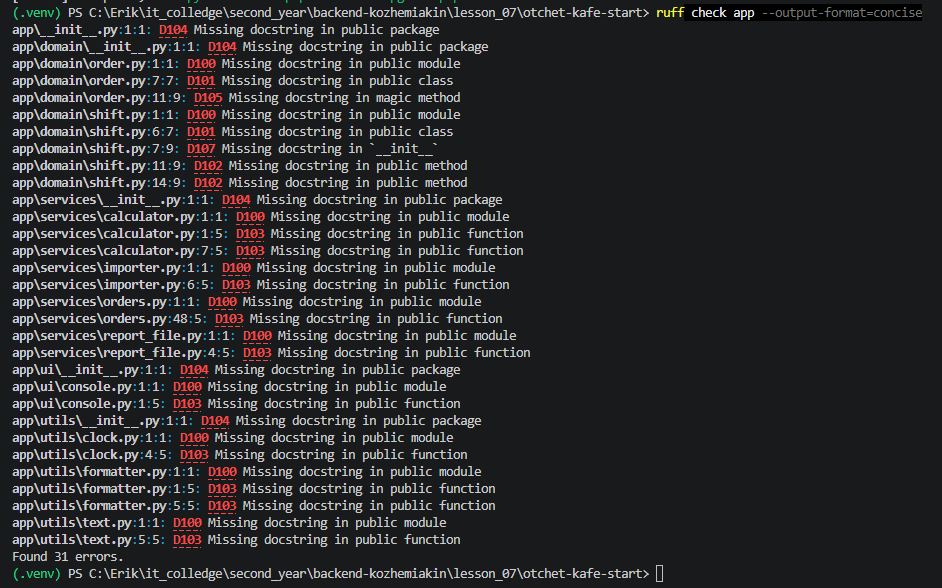
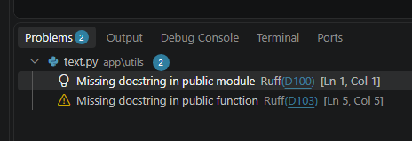
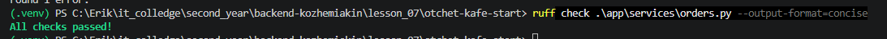
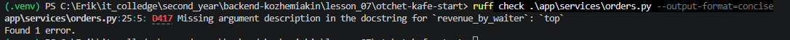
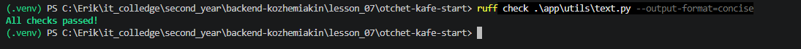

# Отчёт · Докстринги в VS Code: генератор и проверка

**Студент:** Кожемякин Эрик, группа: 9/2-РПО-25/1

Работа выполнена на втором архиве проекта «Отчёт кафе»
(`lesson_07/otchet-kafe-start`), глава 4.10.

## 1. Расширения

Установлены расширения `njpwerner.autodocstring` и `charliermarsh.ruff`.
Автор autoDocstring на карточке расширения: Nils Werner. Издатель Ruff: Astral Software
astral.sh.



## 2. Настройки проекта

Настройки генератора записаны в файл `.vscode/settings.json`. Он лежит внутри проекта
и попадает в репозиторий, поэтому заготовка у всех, кто откроет проект,
будет одинаковой.



Формат заготовки — `google`. С проверкой Ruff он согласуется, потому что
в `pyproject.toml` записано `convention = "google"`. Настройка
`startOnNewLine` оставлена `false`: иначе Ruff выдаст замечание `D212`.

## 3. Заготовка генератора

Генератор вызван у функции `revenue_by_waiter` способом: `ввел """ и нажал enter`.



В заготовке разделы `Args`, `Raises` и `Returns`. Раздел `Raises:` появился,
потому что в теле функции есть `raise ValueError("Список заказов пуст")`. Типы в скобках есть, потому что
выбран формат google (типов нет у формата google-notypes).

## 4. Заполненный докстринг



Краткая строка: «Считает выручку по каждому официанту.». Параметр `top` описан так: «Сколько официантов оставить в результате. Значение 0 - оставить всех.».

## 5. Сниппет

Сниппет записан в файл `python.code-snippets`. Его название — «Докстринг в формате Google», слово для вызова — `dsg`. Им вставлен докстринг функции `load_orders`.



Имя параметра `path` в сниппет вписано вручную: сниппет вставляет ___
текст для любой функции и подпись не читает.

## 6. Проверка всего пакета

Команда `ruff check app --output-format=concise` закончилась строкой
`Found 31 errors.`



Чаще других в выводе два кода. `D100` означает: отсутствие docstring у модуля.
`D103` означает: отсутствие docstring у функции.

## 7. Замечания в редакторе

Модуль моего варианта — `utils.text`. В панели Problems у него 2 замечания.
Источник у каждого замечания — `Ruff`.



## 8. Модуль orders.py без замечаний

Докстринг модуля `orders.py`: «"""Модуль работы с заказми."""».
Докстринг `sort_orders_in_place`: 
```
    """Сортировка заказов прямо внутри списка.
    
    Args:
        orders: список заказов
    
    Returns:
        None
    """
```



## 9. Опыт с D417

После удаления строки про `top` проверка вывела:
`app\services\orders.py:25:5: D417 Missing argument description in the docstring for revenue_by_waiter: top`.



Правило D417 сравнивает раздел `Args:` с сигнатурой функции. Остальные правила
из вывода проверяют, есть ли докстринг и как он оформлен. После опыта
строка про `top` возвращена.

## 10. Модуль моего варианта

До работы проверка модуля `utils.text` выводила `Found 2 errors.`, после —
`All checks passed!`. В пакете `app` осталось `Found 27 errors.`



Докстринг одной из функций модуля:

```python
def normalize_name(name: str) -> str:
    """Удаляет лишние пробелы.
    
    Args:
        name: исходная строка
    
    Returns:
        строка без лишних пробелов
    """

```

## 11. Итог

Ruff проверяет, что докстринг есть, оформлен по правилам и перечисляет
все параметры подписи. Верность описания по смыслу Ruff не проверяет:
докстринг с текстом `bla bla bla` для него в порядке.

ИИ: не использовался
